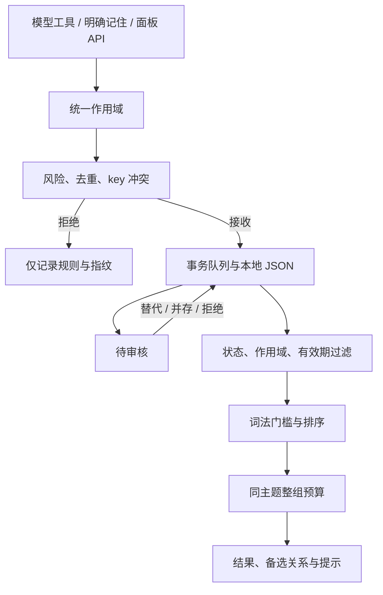

# Architecture

## Modules

- `scope.js`: shared scope resolution and absolute project-directory normalization.
- `store.js`: governance, retrieval, lifecycle, review tokens and local persistence; no DSH dependency.
- `index.js`: tools, policy, explicit events, four HTTP routes and optional session project discovery.
- `client.js`: host-provided React, one settings slot, explicit project selection, conflict comparison and review actions.

## Persistence and review

Every mutation—including search access counters and audit—is queued as read/check/change/commit. The operation clones committed state, validates and changes the draft, writes a uniquely named sibling temporary file, and renames it over the target. In-memory state is published only after successful persistence. A failed operation rejects its caller without poisoning later queued operations.

Replacement archives all current conflicting Active records and activates the candidate in that same commit. Coexistence records reciprocal links. Restore and identity edits recheck current conflicts. The review token covers the candidate and its current active peers (identity, scope, risk and coexistence); access counters and recency updates do not invalidate review. Stale approval returns HTTP 409.

The queue coordinates a single Store instance. There is no cross-process lock or fsync guarantee; two processes must not share one store file. The complete JSON is still rewritten on each commit, so this design is intended for small local stores, not a high-throughput database.

## Retrieval

1. Filter by Active status, expiry and scope. Exclude unbound legacy projects.
2. Require lexical evidence before ranking. Multi-character Chinese queries require a shared bigram or longer/exact match rather than only one common character.
3. Rank by token overlap, substring affinity, importance, recency and pin state.
4. Expand a matched record to eligible records with the same nonempty key and exact scope. Include unmatched alternatives explicitly; this is the intentional exception to the lexical gate.
5. Admit or skip the entire group under both item and body-character budgets. Emit a warning when alternatives cannot fit.
6. Return coexistence approval metadata, provenance and ranking scores. Scores are heuristics, not probabilities.

Legacy multiple Active records sharing a key are marked unresolved until the user resolves them. Global and project records have different scopes and are not automatically treated as one conflict group.

The character budget excludes metadata and warning text; token estimates use body length / 4 and are not model-tokenizer measurements.

## Projects and compatibility

Model tools resolve project scope from Session cwd or an explicit absolute scopeKey. The API, store, explicit capture and UI use the same normalization. The dashboard obtains project suggestions from existing memories and optional sessions; manual absolute-directory entry works without the sessions service.

Schema 1 remains readable. Legacy default/relative project keys remain unchanged and unbound until a user assigns them. Text normalization does not resolve symlinks or filesystem-specific path aliases.

## Extension seam

Other plugins may inject memoryGuardian and call its public store methods. Future retrieval or persistence adapters can preserve the governance and API contracts.
